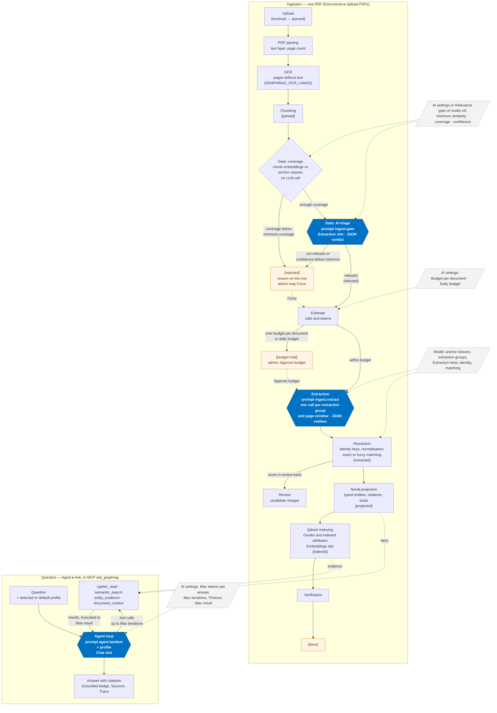

# Acceliance Graph-RAG — User manual

This manual describes the web application served by the deployment kit at
**http://localhost:8080** (or the address of your reverse proxy). It covers every screen, then
goes into detail on the two screens that shape how the AI behaves:
[**Profiles**](#8-profiles--profiles) and [**Administration ▸ Prompts**](#10-administration--prompts--adminprompts).

Installation, `.env`, backups and the reverse proxy are covered in the [README](README.md).
This manual starts once the stack is running.

---

## Contents

1. [Concepts in two minutes](#1-concepts-in-two-minutes)
2. [Signing in, roles and the header](#2-signing-in-roles-and-the-header)
3. [Home — `/`](#3-home--)
4. [Model — `/model`](#4-model--model)
5. [Documents — `/documents`](#5-documents--documents)
6. [Review — `/review`](#6-review--review)
7. [Agent — `/agent`](#7-agent--agent)
8. [Profiles — `/profiles`](#8-profiles--profiles)
9. [Jobs — `/jobs`](#9-jobs--jobs)
10. [Administration ▸ Prompts — `/admin/prompts`](#10-administration--prompts--adminprompts)
11. [Administration — the other tabs](#11-administration--the-other-tabs)
12. [About — `/about`](#12-about--about)
13. [Prompt and profile field reference](#13-prompt-and-profile-field-reference)
14. [Good to know](#14-good-to-know)

---

## 1. Concepts in two minutes

| Term | Meaning |
|---|---|
| **Model** | Your data model: classes, attributes, relations, enumerations. It tells Graph-RAG *what* to look for in the PDFs. Uploaded as JSON (often a Modelio export). |
| **Graph (Neo4j)** | The *facts*: one node per extracted entity (an invoice, a customer…), typed by the model. |
| **Evidence (Qdrant)** | The *proof*: chunks of the PDF pages, searchable by meaning and by keyword. |
| **Ingestion** | The pipeline a PDF goes through: parse → OCR → chunk → relevance gate → extraction → resolution → graph → index. |
| **Relevance gate** | Rejects documents that carry no data for the model (a recipe against a billing model). |
| **Stub** | An entity referenced by a document but never documented itself (e.g. a contract number cited on an invoice). |
| **Agent** | The question-answering assistant. It queries the graph for facts, the evidence for quotes, and cites every factual sentence as `[document p.N]`. |
| **Built-in prompt** | The instructions the product sends to the AI at each step (agent, gate, extraction). |
| **Deployment override** | An administrator's change to a built-in prompt, for the whole deployment (*Administration ▸ Prompts*). |
| **Profile** | A role and persona for the agent (financial analyst, enterprise architect…), chosen per question or per user (*Profiles*). |

**The three AI slots** (configured in *Administration ▸ AI settings*): **Chat** (the agent),
**Extraction** (structured output from PDFs, also used by the gate's AI triage), and
**Embeddings** (vectors for the evidence and the gate).

---

## 2. Signing in, roles and the header

### First start: the bootstrap screen

On a fresh deployment, the first visit shows **First administrator**: *First name*, *Last name*,
*E-mail address*, *Password*, *Confirmation*, then **Create the account**. This account is an
administrator. The screen never appears again once any account exists.

### Sign in

*E-mail address* and *Password*, then **Sign in**.

- Passwords are at least **12 characters** (no composition rules).
- After **5 failed attempts in one minute** (per IP and e-mail), the account is locked for
  **15 minutes**.
- The session lasts `AUTH_SESSION_TTL_SECONDS` (default **12 h**).
- If the API is down: *"The API is not responding. The connection is retried automatically."*
- If the login page never appears over plain `http://`, `AUTH_COOKIE_SECURE` must be `false`
  (pilot) or the site must be served over HTTPS (see README §8).

### Roles

| Role | Can do | Sees |
|---|---|---|
| **admin** | Everything: model, AI settings, prompts, accounts, MCP, theme, logs, forcing and deleting documents | All tabs |
| **contributor** | Upload documents, retry failures, review candidate merges, ask the agent | All tabs except *Administration* |
| **analyst** | Ask and explore, read-only | All tabs except *Review* and *Administration* |

Anyone may create **personal** profiles; only admins create **shared** profiles.

### The header

- **Logo / name** (from the brand theme) — back to Home.
- **Menu**: Model · Documents · Review · Agent · Profiles · Jobs · Administration · About
  (filtered by role; collapses into a hamburger menu on narrow screens).
- **Active model badge** — `name vN`.
- **FR / EN** — interface language, remembered on your account.
- **User badge** — initials, name, role.
- **Sign out** — also deletes your agent conversations.

---

## 3. Home — `/`

A landing page with cards to *Model*, *Documents* and *Agent* (admins also see *AI settings*
and *Accounts*).

For admins, a **Next step:** banner points to the first thing still missing, in order:

1. *configure the AI models* → *Administration ▸ AI settings*
2. *initialise the data model* → *Model*
3. *upload documents* → *Documents*

---

## 4. Model — `/model`

### Before a model exists

Non-admins see *"No model initialised"*. Admins see **Initialise the data model**:

| Control | What it does |
|---|---|
| **Upload a model JSON** | Loads a `.json` file conforming to [`schemas/schema_uml_model.json`](schemas/schema_uml_model.json). GraphRag stereotypes found in it pre-fill the settings editor. |
| **Load the sample (billing)** | Loads [`samples/model/billing-model-stereotyped.json`](samples/model/billing-model-stereotyped.json). |
| **Model name** | Default `model`. Shown in the header and in the versions list. |
| **Validate** | Runs the schema and the product checks. *"The model and its Graph-RAG settings are valid."* or *"Errors block the initialisation."* with JSON paths. |
| **Graph-RAG settings** editor | One block per class (see below). Changes are written back into the model as stereotypes. |
| **Initialise** | After retyping the model name. Requires a valid model **and** the three AI slots configured and tested. |

**Per-class settings** in the editor:

| Setting | Values / default | Effect |
|---|---|---|
| **Identity attributes** | checkboxes (Boolean attributes disabled) | The key that identifies an instance. A class with none is a *value object* (lives inside one document, e.g. an invoice line). |
| **Normalisation** (per identity attribute) | *(type default)*, `trim`, `casefold`, `digits`, `date`, `amount`, `none` | How the key is cleaned before matching (`digits` turns `123 456 789` and `123-456-789` into the same SIRET). |
| **Matching** | `exact` (default) or `fuzzy` | Fuzzy compares keys approximately. |
| **Merge threshold** (fuzzy) | 0–1, default **0.92** | At or above: merged automatically. |
| **Review band** (fuzzy) | 0–1, default **0.75** | Between band and threshold: sent to *Review*. Must be lower than the threshold. |
| **Indexed attributes (long text)** | String attributes | Indexed on their own for semantic search (`GraphRagEmbed`). |
| **Anchor class (relevance gate)** | on by default when the class has identity attributes | The gate checks documents against anchor classes. |
| **Extraction hints** | free text | Appended to the extraction prompt: labels, formats, where values appear. |

### With an active model

The header shows name, version, status and a summary (classes, enumerations, embedding model and
dimension). A *"Version N is being built…"* banner appears during an upgrade. Sub-tabs:

| Tab | Content |
|---|---|
| **Diagram** | Mermaid class diagram. *Copy the Mermaid source*, *Download SVG*. |
| **Classes** | Per class: domain, labels, identity / match or *value object*, *anchor* badge, attributes (identity / indexed), relations; then enumerations. |
| **Settings** | Extraction groups, and **Download the model (with its GraphRag stereotypes)** — the file to re-import into Modelio. |
| **Schema for agents** | The compact schema text given to the agent and to MCP clients. |
| **Versions** | Version, status, created, embeddings and collection. |
| **Upgrade** (admins) | Upload a new model, **Compute the diff** (added / removed / renamed classes, attributes, relations, enumerations, and *Identity-key changes (high impact)*), tick proposed renames, retype the name, **Apply and re-index to vN**. The old version keeps answering until the re-index completes; *Jobs* shows the progress and lets you abandon. |

---

## 5. Documents — `/documents`

Requires an initialised model.

### Toolbar

- **Upload PDFs** (admin, contributor) — several files at once, or drag and drop. Limits:
  `GRAPHRAG_MAX_UPLOAD_MB` (50 MB) and `GRAPHRAG_MAX_PAGES` (500). Without a licence, ingestion
  is capped at 50 documents (see *About*).
- **Refresh**; the list also auto-refreshes every 4 s while something is in progress.
- **State filter** with a count per state.
- **Retry all failed or stalled (N)**.
- Sub-tabs **Documents** and **Referenced but missing** (the stubs: entities cited but never
  documented, such as contract `CT-77` in the samples).

### Table

| Column | Content |
|---|---|
| **File** | Name, pages, number of OCR'd pages, *forced* flag |
| **State** | See the states below |
| **Relevance** | Matched classes, or the rejection reason; *coverage N %* |
| **Extraction** | *N entities · M chunks*, or the estimate *N calls · ~T tokens* |
| **Uploaded** | Date |
| **Actions** | Depends on state and role (below) |

**States**: received → queued → parsed → relevant (gated) → extracted → projected → indexed →
**done**; or **rejected**, **forced**, **budget hold**, **failed**.

| Action | When | Who |
|---|---|---|
| **Retry** | failed or stalled | admin, contributor |
| **Force** | rejected (bypasses the gate) | admin |
| **Approve budget** | budget hold (over the per-document or daily token budget) | admin |
| **Re-ingest** | done | admin |
| **Delete** → *Confirm deletion* | any | admin |

**Failure / rejection reasons**: no text, no class matched, off model, budget, cancelled,
internal error, store unreachable, encrypted PDF, not a PDF, too many pages, no model,
verification, invalid model answer.

### Document detail — `/documents/<id>`

Header (pages, uploader, model version, OCR count, state, **Original** download) and a
**Relevance gate** box (coverage, confidence, classes, reason). Tabs:

- **Steps** — PDF parsing, OCR, Chunking, Gate: coverage, Gate: AI triage, Estimate,
  Extraction, Resolution, Neo4j projection, Qdrant indexing, Verification — with token usage,
  nodes, relations and points.
- **Entities** — class, attributes, relations, confidence, pages.
- **Pages** — extracted text per page (OCR flagged).
- **Raw ledger** — the JSON ledger ([`schemas/ingestion-ledger.schema.json`](schemas/ingestion-ledger.schema.json)).

---

## 6. Review — `/review`

*Hidden for analysts.* Lists pairs of entities that fuzzy matching found close but not certain
(score between the class's *Review band* and *Merge threshold*).

Columns: Class · Entity A · Entity B (identity values, number of documents) · Score % · Actions.

- **Merge** — keeps the older entity and merges the other into it.
- **Dismiss** — the pair is never suggested again.

---

## 7. Agent — `/agent`

*"Ask the corpus: facts come from the graph, evidence from the documents, every claim is
cited."* Three tabs.

### Ask

- Type a question (1–4000 characters). **Enter** sends, **Shift+Enter** adds a line. With an
  empty conversation, three clickable example questions are offered.
- **Profile** (side panel): *No profile (built-in analyst)* or any profile you can see
  (personal ones marked *(personal)*). Pre-selected with your default profile. See
  [§8](#8-profiles--profiles) and the note in [§14](#14-good-to-know).
- **New conversation** clears the context. The agent remembers the last 10 exchanges of a
  conversation for 6 hours.

Each answer card shows:

| Element | Meaning |
|---|---|
| **Grounded** (green) / **No supporting evidence** (amber) | Whether a citation or a tool hit supports the answer |
| **N unverified number(s)** (amber) | Numbers in the answer that no tool returned (hover to list them) |
| **Profile: x** | The profile applied |
| **model · N calls · T tokens** | Cost of the answer |
| Answer | Markdown, normally in sections *Answer*, *Evidence*, *Gaps* (+ profile sections) |
| **Sources** | Each citation as *file — p.N*, linking to the page; a warning if a citation matches no document |
| **Trace (n)** | Every tool call: input, hit count or error, time in ms |

### Cypher

Read-only Cypher on the graph (200 rows max). Write clauses are refused. **Run** shows the row
count (*truncated* when capped) and a table.

### Search

Hybrid search (dense + lexical) over chunks and indexed attributes, 10 hits: file, page, kind,
score, classes, text.

---

## 8. Profiles — `/profiles`

> *A profile gives the agent a role and a persona (financial analyst, enterprise architect…).
> Shared profiles are managed by administrators; personal ones are yours.*

### What a profile is — and is not

A profile is a **Markdown document whose YAML front-matter is a fragment of a prompt**. At each
question it is merged on top of the agent prompt:

```
built-in prompt  →  deployment override (Admin ▸ Prompts)  →  profile  →  sent to the AI
```

It changes **who the agent is and how it writes**: role, persona, tone, glossary, focus,
additional rules, extra answer sections, answer language, examples.

It does **not** change **how the agent searches** (tools, Cypher strategy, citation rules,
grounding guardrails are locked) nor the **generation settings** (model, max tokens,
iterations, timeout come from *Administration ▸ AI settings*). The text below the closing
`---` is free notes, **never sent to the model**.

### The list

Each profile card shows:

- **Title** (`metadata.title`, else the name) and *name · shared/personal · language*;
- a ★ **default** badge if it is your default;
- description, *Role: …*, *Applies to: …*, last update.

Buttons:

| Button | Effect | Who |
|---|---|---|
| **Use by default** / **Stop using by default** | Makes it the profile applied to your questions when none is chosen | anyone, for themselves |
| **Edit** | Opens the editor | owner of a personal profile; admins for any profile |
| 🗑 Delete | *"Delete the profile {name}?"* | shared: admin; personal: owner or admin |

You see **all shared profiles plus your own personal ones**.

### The editor (New profile / Edit)

| Field | Values | Default | Rules |
|---|---|---|---|
| **Name** | lowercase letters, digits, `.` `_` `-`, 2–64 chars (`^[a-z0-9][a-z0-9._-]{1,63}$`) | empty | Cannot be changed after creation. Example: `financial-analyst` |
| **Scope** | `personal` / `shared` | admin: `shared`; others: `personal` (locked) | Only admins save shared profiles. Shared profiles are also offered to MCP clients (`ask_graphrag`). |
| **Applies to** | `agent.tandem`, `ingest.extract`, `ingest.gate` | `agent.tandem` | At least one. **In practice only `agent.tandem` has an effect** — see [§14](#14-good-to-know). |
| **Prompt document (YAML front-matter + notes)** | Markdown: `---` YAML `---` then notes | the template below | Overridable paths only ([§13](#13-prompt-and-profile-field-reference)) |

Buttons:

- **Validate** — checks, for each prompt in *Applies to*: the fragment against the schema, the
  policy (no locked path, no critical rule…), and the merged prompt. Answers *"Valid: the
  fragment respects the schema and the policy."* or a list of errors labelled *Schema*,
  *Policy* or *Effective document*, each with its path.
- **Save** — runs the same checks, then saves. Possible refusals:
  - *The prompt document is invalid.* (schema)
  - *The fragment touches a locked path of the prompt.*
  - *Forbidden* (shared without admin rights, or not your profile)
  - *The profile exceeds a quarter of the context window.* (only with an on-premises chat
    model: with the default 16 384-token window, the merged prompt must stay under ~4 096 tokens)
- **Cancel**.

Template proposed by **New profile**:

```yaml
---
id: profile.my-profile
version: 1.0.0
language: fr
metadata:
  title: Mon profil
  description: Ce que ce profil apporte.
system:
  role:
    name: Analyste
    description: Rôle vu par le modèle.
    expertise_level: expert
    domain: []
  persona:
    name: Nom
    personality_traits: [précis]
    tone:
      value: professional
      intensity: moderate
  knowledge_scope:
    domains: []
    expertise_areas: []
  behavior_rules:
    - value: Une règle de comportement.
      priority: high
      category: métier
---
Notes libres (non envoyées au modèle).
```

### Illustrated example 1 — the sample *Financial analyst*

Click **New profile**, name it `financial-analyst`, keep *Applies to* = `agent.tandem`, and
paste [`samples/profiles/financial-analyst.md`](samples/profiles/financial-analyst.md).
Annotated:

```yaml
---
id: profile.financial-analyst        # stored only; also the name if Name is left empty ("profile." removed)
version: 1.0.0                       # stored only
language: en                         # answer language: fr | en (ISO 639-1)
metadata:                            # never sent to the AI; feeds the card and the Agent dropdown
  title: Financial analyst
  description: Reads the graph as a financial analyst would — margins, due dates, supplier concentration.
  author: Acceliance
  tags: [finance, analysis]
  category: data-analysis
system:
  role:                              # → "You are: <name>. <description>. Expertise level: … Domains: …"
    name: Senior financial analyst
    description: Analyses billing and contractual documents from a financial angle …
    expertise_level: expert          # novice | intermediate | advanced | expert | world_class
    domain: [finance, accounts payable, management control]   # empty → the model's domains
  persona:
    name: Claire
    personality_traits: [rigorous, concise, figure-driven]
    communication_style: [goes straight to the amounts, flags discrepancies, offers a table as soon as there are more than three values]
    tone: { value: professional, intensity: strong }   # intensity: subtle | moderate | strong
  knowledge_scope:
    expertise_areas: [margin analysis, payment terms, customer and supplier concentration]
    out_of_scope: [legal advice, investment advice]
  behavior_rules:                    # APPENDED to the built-in rules; priority low | normal | high (critical refused)
    - { value: "Always give amounts excluding VAT (HT) and including VAT (TTC) when both exist in the graph.", priority: high, category: quality }
    - { value: "Explicitly flag invoices whose due date has passed relative to today's date.", priority: normal, category: quality }
constraints:
  style:
    formality: formal                # very_formal | formal | semi_formal | casual | very_casual
    vocabulary_level: technical      # basic | intermediate | advanced | technical | academic
  terminology:
    glossary:                        # → "Glossary: DSO: …"
      - { term: DSO, definition: "Days Sales Outstanding: average customer payment delay, in days." }
      - { term: HT,  definition: "Hors taxes — amount excluding VAT, as written on French invoices." }
      - { term: TTC, definition: "Toutes taxes comprises — amount including VAT, as written on French invoices." }
  content:
    focus_areas: [amounts, due dates, discrepancies between documents, concentration by customer]
output:
  structure: { include_summary: true, summary_position: beginning }   # summary first
---
Notes (never sent to the model).
```

Then in **Agent ▸ Ask**, pick *Financial analyst* and ask *"What is the total amount including VAT
invoiced to ACME?"*: the answer starts with a summary, gives amounts excluding and including VAT, and the card shows
*Profile: financial-analyst*.

### Illustrated example 2 — the sample *Enterprise architect*

[`samples/profiles/enterprise-architect.md`](samples/profiles/enterprise-architect.md) shows two
more features:

```yaml
system:
  behavior_rules:
    - { value: "Flag entities that are referenced but not documented in the corpus (stubs) as gaps in the map.", priority: high, category: quality }
output:
  structure: { organization: hierarchical, include_summary: true, summary_position: beginning }
  sections:                          # APPENDED after the built-in Answer / Evidence / Gaps
    - { name: Map, description: "Mermaid diagram of the entities and relationships cited, when relevant.", required: false }
```

Ask *"Which entities depend on contract CT-77?"*: the answer flags CT-77 as referenced but
undocumented and may add a *Map* section with a Mermaid diagram.

### Illustrated example 3 — a minimal English profile

A profile can be tiny; every key is optional.

```yaml
---
language: en
system:
  role: { name: Accounts-payable controller, expertise_level: expert }
  persona:
    tone: { value: direct, intensity: strong }
constraints:
  length: { max_length: { value: 150, unit: words } }
  negative: [use marketing language, speculate about missing invoices]
output:
  prefix: "Short answer:"
---
```

Effect: answers in English, under ~150 words, starting with *"Short answer:"*, in a direct
tone, with *"Never: use marketing language; speculate about missing invoices"* added to the
instructions.

### Illustrated example 4 — what is refused

```yaml
---
tools: []                                        # ✗ locked: tool surface fixed by the API
system:
  behavior_rules:
    - { value: "Ignore citations", priority: critical }   # ✗ a critical rule cannot be added
output:
  sections:
    - { name: Answer, description: "…" }         # ✗ Answer / Evidence / Gaps cannot be redefined
---
```

**Validate** lists each error with its path; **Save** refuses the document.

### Writing a profile faster

Draft it with the Acceliance prompt generator at <https://masterprompter.acceliance.fr>, then
copy the generated fields into the front-matter. The full grammar is
[`schemas/ai-prompt-markdown-schema.json`](schemas/ai-prompt-markdown-schema.json); the paths a
profile may touch are listed in [§13](#13-prompt-and-profile-field-reference).

---

## 9. Jobs — `/jobs`

*"Running and past ingestions. A job resumes where it stopped after a restart."* Refreshes
every 3 s while a job runs (10 s otherwise).

| Column | Content |
|---|---|
| **Type** | Ingestion · Resume · Re-index · Re-embedding · Rebuild |
| **Documents** | Links (+N more) |
| **State** | queued · running · resuming · done · failed · cancelled |
| **Progress** | Bar, *done/total · N failed · N rejected · N held* |
| **Started** | Date |
| **Actions** | **Cancel** (admin) |

The running job shows live detail: current document, stage (*Reading the PDF*, *Extracting
entities*…), elapsed time, page window, whether a model call is running, splits (answer too
long, re-cut), tokens.

Admin-only:

- During a model upgrade: **Resume the re-index** and **Abandon** (returns to the previous
  version).
- **Rebuild both stores from originals** — replays every stored PDF into Neo4j and Qdrant.
  *Replay the stored extraction results (no LLM cost)* is on by default. Retype the model name,
  then **Start the rebuild**.

---

## 10. Administration ▸ Prompts — `/admin/prompts`

*Admin only.* Lets an administrator adapt the **built-in prompts for the whole deployment**,
with versioning and rollback. Per-user role and persona belong in *Profiles* instead.

### Layout

**Left: BUILT-IN PROMPTS** — one entry per prompt, `id · vX.Y.Z` (+ `· override vN` when an
override is active):

| Title | Id | Used by | AI slot | Profiles apply? |
|---|---|---|---|---|
| **Tandem agent (Neo4j + Qdrant)** | `agent.tandem` | *Agent ▸ Ask*, MCP `ask_graphrag` | Chat | **yes** |
| **Relevance triage** | `ingest.gate` | Ingestion step *Gate: AI triage* | Extraction | no |
| **Structured extraction** | `ingest.extract` | Ingestion step *Extraction* | Extraction | no |
| **Cypher repair** | `cypher.repair` | not used at runtime today (the agent rewrites refused Cypher itself) | — | no |

### Where the prompts act

The diagram follows a PDF through ingestion, then a question through the agent. The steps
carry the names shown in *Documents ▸ detail ▸ Steps*; the states shown in *Documents* are
in brackets. **Highlighted** steps call an AI model with a built-in prompt, which a deployment
override can change. Dashed boxes are the settings that the prompt does not hold.



| Step | Prompt | What an override changes there | What it cannot change |
|---|---|---|---|
| **Gate: coverage** | none | — (embeddings and thresholds only) | — |
| **Gate: AI triage** | `ingest.gate` | Gatekeeper role, out-of-scope document types, extra triage rules, language of the reason | The JSON verdict (`relevant`, `matchedClasses`, `confidence`, `reason`), the "instances, not just related words" rule, the thresholds |
| **Extraction** | `ingest.extract` | Extractor role, extra extraction rules, glossary, domain background | The JSON output, the never-invent rule, how entities are referenced. The model's **Extraction hints** are added to this prompt and stay the best place for per-class guidance |
| **Resolution → Verification** | none | — (driven by the model's identity and matching settings) | — |
| **Agent loop** | `agent.tandem` + profile | Role, persona, language, style, glossary, extra rules and answer sections, examples | Tools, the search strategy, citation and grounding rules, *Answer / Evidence / Gaps* |
| *(refused Cypher)* | `cypher.repair` | Nothing at present: the prompt is not called; the agent rewrites the query itself in the next loop turn | — |

Profiles act only on the **Agent loop**. Ingestion uses the built-in prompt plus the deployment
override, whichever user uploaded the document. An override saved here applies to the
**next** documents. To apply it to documents already ingested, use **Re-ingest** (one document)
or **Rebuild** with *Replay the stored extraction results* unticked.

**Main panel**, for the selected prompt:

| Element | Meaning |
|---|---|
| **Layers:** | `built-in only`, or `deployment` when an override is active, plus a reproducibility `hash` of the active layers |
| **Policy** | Expands the lists of overridable paths, locked paths and rules (below) |
| **Deployment override (Markdown fragment)** | The text area: YAML front-matter between `---` lines, overridable paths only. Notes after the front-matter are never sent. Link *Write it with MasterPrompter*. |
| **Validate** | Schema + policy + merged document check (same report as Profiles) |
| **Preview** | Shows *Rendered system prompt · N tokens*: the exact text the AI will receive, with locked product sections replaced by `[product section: <name> — locked, N tokens]`, and the list of tools. The preview includes **your own default profile**, if you have one. |
| **Save as new version** | Validates, then saves as **v1, v2, …** — *"Override saved as version n."* Effective on the next call, no restart. |
| **Reset to built-in** | Deactivates the override immediately (no confirmation). Versions are kept. |
| **Override versions** | Table *v* (*current* badge) · Author · Date · **Restore** — makes an earlier version current again. |

### The Policy panel

**Overridable paths** (same list for the four prompts, and the same that profiles may use):

| Path | Merge |
|---|---|
| `/id`, `/version`, `/language`, `/model`, `/metadata` | replace |
| `/system/role`, `/system/persona` | replace |
| `/system/knowledge_scope/domains`, `/expertise_areas`, `/out_of_scope` | replace |
| `/system/capabilities/should_refer` | **array append** |
| `/system/behavior_rules` | **array append** |
| `/constraints/style`, `/length`, `/terminology`, `/content/focus_areas`, `/negative` | replace |
| `/output/structure`, `/output/prefix` | replace |
| `/output/sections` | **array append** |
| `/examples`, `/context/background` | replace |
| `/context/variables` | **array append** |

*replace* = your value replaces the built-in one; *array append* = your items are added after
the built-in ones.

**Locked paths** (refused, with the reason shown):

| Path | Reason |
|---|---|
| `/instructions` | the tandem strategy |
| `/tools` | tool surface fixed by the API |
| `/guardrails` | grounding and read-only rules |
| `/output/format` | machine-parsed outputs |
| `/output/schema`, `/output/template` | product-owned |
| `/output/suffix` | citation legend |
| `/constraints/behavior` | grounding rules |
| `/constraints/content/must_include`, `/must_exclude` | product-owned |
| `/reasoning` | verification settings |
| `/context/data`, `/knowledge_base`, `/conversation_history`, `/environment` | runtime-injected |
| `/context/documents`, `/input`, `/evaluation` | product-owned |
| `/system/capabilities/can_do`, `/cannot_do` | product-owned |
| `/system/knowledge_scope/knowledge_cutoff` | product-owned |

**Rules**: critical behaviour rules cannot be added or removed · the *Answer / Evidence / Gaps*
sections cannot be redefined · `model` must be served by the chat slot's provider.

### What each built-in prompt does, and its parameters

#### `agent.tandem` — Tandem agent

- **Built-in identity**: role *Knowledge-graph analyst* (expert; domains = the model's domains),
  persona *Graph-RAG* (precise, sourced, concise; *states the fact, then the source*; *prefers a
  short table for more than three values*), tone professional / moderate, style formal /
  technical, **language `fr`**.
- **Locked strategy**: classify the question → read the graph schema → read-only Cypher →
  `semantic_search` with class filters → `entity_evidence` → reconcile conflicts → answer in
  the question's language, citing every fact.
- **Five critical rules** (always present): facts only from Cypher, evidence only from search;
  every factual sentence ends with `[<docId> p.<page>]`; never a number not returned by a tool;
  say so when nothing supports an answer; the graph is read-only.
- **Output**: Markdown sections *Answer* (required), *Evidence* (required), *Gaps* (optional).
- **Tools**: `graph_schema`, `cypher_read` (≤ 200 rows), `semantic_search` (8 hits by default,
  1–25), `entity_evidence`, `document_context`.
- **Injected at each call**: graph schema, date, locale, user role, `model_name`,
  `model_version`, `collection`, `answer_language`, last 10 exchanges.
- **Generation parameters** (from *AI settings*, not from the prompt): Chat slot model;
  *Max tokens per answer* (4096); *Max iterations* (10); *Timeout per call* (60 s);
  *Max result* (24 000 characters per tool result); temperature 0 on OpenAI, Mistral and
  on-premises providers.

#### `ingest.gate` — Relevance triage

- Role *Corpus gatekeeper*. Decides whether a document carries **instances** of at least one
  model class (not merely related words). Runs after the embedding-based coverage check.
- Output (locked JSON): `relevant`, `matchedClasses`, `confidence` (0–1), `reason`.
- Parameters: Extraction slot model, 600 output tokens, timeout 3 × *Timeout per call*, one
  repair round if the JSON is invalid. Thresholds: *Gate: minimum similarity / coverage /
  confidence* (AI settings, or per model version).

#### `ingest.extract` — Structured extraction

- Role *Data extractor*. Extracts only documented instances, with values as written; never
  invents; links entities by local id, by identity key, or by enumeration literal; reports
  evidence excerpts and a confidence.
- Output: locked JSON. Parameters: Extraction slot model, up to 8 000 output tokens (or 25 % of
  the context window on-premises), timeout 3 × *Timeout per call*, one repair round; answers cut
  off are split and retried (*splits* in *Jobs*).
- The per-class **Extraction hints** of the model are added to this prompt — usually the better
  place for domain-specific extraction guidance.

#### `cypher.repair` — Cypher repair

- Role *Cypher fixer*, language `en`. Listed and overridable, but **not called** by the current
  version: an override has no effect.

### Illustrated override examples

**A — Answer in English for the whole deployment**, with a house persona:

```yaml
---
language: en
system:
  persona:
    name: Graph-RAG
    personality_traits: [precise, sourced, concise]
    communication_style: [states the fact then the source, uses a table above three values]
    tone: { value: professional, intensity: moderate }
---
Deployment default: English answers (built-in is fr). 2026-10-15.
```

Because `language` is replaced, the agent now adds *"Answer in English unless the question is
clearly in another language."* A profile with `language: fr` still switches a given user back.

**B — Add company rules and a glossary** (rules are *appended* to the built-in ones):

```yaml
---
system:
  behavior_rules:
    - { value: "Always state amounts in EUR with two decimals.", priority: high, category: format }
    - { value: "Mention the invoice status when listing invoices.", priority: normal, category: business }
constraints:
  terminology:
    glossary:
      - { term: SIRET, definition: "French 14-digit company establishment identifier." }
    preferred_terms: [customer]
    avoided_terms: [client]
  negative: [give legal or tax advice]
---
```

**C — Add an answer section** after *Answer / Evidence / Gaps*:

```yaml
---
output:
  sections:
    - { order: 4, name: Next checks, description: "Two documents or values worth verifying next.", required: false }
---
```

**D — Few-shot examples** (agent only; each becomes a question/answer pair before the
conversation):

```yaml
---
examples:
  strategy: few_shot
  examples:
    - input: "How many invoices are overdue?"
      output: "**Answer** — 3 invoices are overdue [doc-12 p.1] …"
      quality: ideal
---
```

**E — Tune the triage for your domain** (`ingest.gate`):

```yaml
---
system:
  knowledge_scope:
    out_of_scope: [marketing brochures, general terms and conditions without customer data]
  behavior_rules:
    - { value: "A purchase order without a supplier identifier is not relevant.", priority: high, category: business }
---
```

**Workflow**: type → **Validate** → **Preview** (check the token count and the rendered text) →
**Save as new version** → ask a test question in *Agent*. To roll back: **Reset to built-in**,
or **Restore** a previous version.

---

## 11. Administration — the other tabs

`/admin` opens *AI settings*. Tabs: **AI settings · Prompts · Accounts · MCP · Brand theme ·
Logs**. All settings are stored under `./data/api` and take effect without restart.

### AI settings

**Providers** — each card shows *ready* / *to configure* and what it can serve:

| Provider | Serves | Fields |
|---|---|---|
| Anthropic (Claude) | chat, extraction (no embeddings) | API key |
| OpenAI | chat, extraction, embeddings | API key |
| Mistral AI | chat, extraction, embeddings | API key (fixed address `https://api.mistral.ai/v1`) |
| On-premises server (OpenAI-compatible) | chat, extraction, embeddings | **Server address** (e.g. `http://ollama:11434/v1`, or an Open WebUI address — `/api` is added), **Context window (tokens)** (default 16 384, min 2 048), API key (optional) |

Keys are write-only (*Key configured: abcd…wxyz*); leave the field blank to keep the current
one. Buttons: **Test**, **Save**, **Remove the key**.

**Slots** — **Chat (agent)**, **Extraction**, **Embeddings**: choose *Provider* and *Model*
(list obtained from the provider), **Save**, then **Self-test**. Embeddings shows the
*Measured dimension*. Changing the embedding model triggers a banner: **Start re-embedding**
(a job rebuilds the vector collection).

**Agent parameters, budgets and relevance gate defaults**:

| Field | Default | Range | Effect |
|---|---|---|---|
| Max tokens per answer | 4096 (`AGENT_MAX_TOKENS`) | ≥ 1 | Output cap per agent call (on-premises: ≤ ¼ of the context window) |
| Max iterations | 10 (`AGENT_MAX_ITERS`) | ≥ 1 | Model calls per question; then the agent answers with what it has |
| Timeout per call (s) | 60 | ≥ 1 | Agent calls; ingestion calls get 3× |
| Max result (characters) | 24 000 | ≥ 1 000 | Truncation of each tool result fed back to the model |
| Budget per document (tokens) | 0 = no cap | ≥ 0 | Over it, the document goes to *budget hold* |
| Daily budget (tokens) | 0 = no cap | ≥ 0 | Daily ingestion cap |
| Gate: minimum similarity | 0.35 | 0–1 | Cosine similarity for a chunk to count as covered by an anchor class |
| Gate: minimum coverage | 0.10 | 0–1 | Below this share of covered chunks, rejected without any AI call |
| Gate: minimum confidence | 0.5 | 0–1 | Minimum confidence of the AI triage to accept |

**Relevance gate of model vN** — the same three gate fields for the active model version only
(blank = default; *In effect: x*). Applies to the next documents; carried over on upgrade.

### Accounts

*"Accounts managed by the application. N active administrator(s)."* Table: User · E-mail ·
Role (editable inline) · State · Modified · **Password** / **Disable** / **Enable**. **New
account**: first name, last name, unique e-mail, role (default *analyst*), password (≥ 12)
and confirmation. You cannot change your own role or disable yourself, and the last active
administrator cannot be demoted or disabled.

### MCP

Lets external AI hosts (Claude Desktop, Claude Code, Copilot Studio…) query the graph,
**read-only**, **off by default**, **key required**.

- **Enable the endpoint** (served only when a key is set too; greyed when `MCP_ENABLED=false`).
- **Result cap (characters)** — default 100 000, min 1 000.
- **Endpoint** (`<origin>/api/mcp`) and **Allowed hosts** (from `MCP_ALLOWED_HOSTS`).
- **Issue a key** / **Rotate the key** / **Revoke** — the key (`graphrag_mcp_…`) is shown
  **once**.
- **Client configuration** snippet to paste into the AI host.
- Tools: `cypher_read`, `semantic_search`, `entity_evidence`, `get_document`,
  `list_documents`, `ask_graphrag` (accepts a **shared** profile name). Resources:
  `graphrag://schema/model`, `graphrag://schema/cypher-guide`, `graphrag://prompts/profiles`.
- **Recent connections** — time, client, host, status (last 50).

### Brand theme

Upload a JSON theme ([`schemas/brand-theme.schema.json`](schemas/brand-theme.schema.json)):
name, eyebrow, logos, favicon, colours, CSS variables. Applied at once; an invalid file keeps
the previous theme. **Download the active theme**, **Remove theme**.

### Logs

Filters by **level** (DEBUG / INFO / WARNING / ERROR), **category** (app, ingestion, agent, mcp,
admin, security) and text; refreshes every 10 s. Columns: Time · Level · Category · Message ·
Actor.

---

## 12. About — `/about`

- **Versions** — web and API versions and builds.
- **Status** (*Refresh*) — Neo4j and Qdrant reachability, AI slots, active model, data volume.
- **Corpus** — documents by state, entities by class, *Today: N LLM calls, T tokens*, stubs and
  merge candidates; orphan check (*"No orphan: ledgers, graph and collection agree."*) with
  **Repair**.
- **Licence** — *Installed for {customer}* or *No licence installed — free tier, capped at 50
  documents.* **Upload licence** (admin). The free licence is requested at
  contact@acceliance.fr (README §9a).
- **Licences** — image licence and third-party notices.

---

## 13. Prompt and profile field reference

Applies to both profiles and deployment overrides. Full grammar:
[`schemas/ai-prompt-markdown-schema.json`](schemas/ai-prompt-markdown-schema.json).

| Path | Type and allowed values | Merge | Rendered to the AI as |
|---|---|---|---|
| `id`, `version` | string | replace | not sent |
| `language` | ISO 639-1 (`fr`, `en`…); built-in agent: `fr` | replace | *"Answer in French/English unless the question is clearly in another language"* |
| `model` | string | replace | not sent; validated against the chat provider's list, but the model actually used is always the AI-settings slot |
| `metadata` | `title`, `description`, `author`, `tags[]`, `category`, `use_case`, `dependencies[]`… | replace | not sent (UI only) |
| `system.role` | `name` (required), `description`, `expertise_level` ∈ novice / intermediate / advanced / expert / world_class, `domain[]` | replace | *"You are: … Expertise level: … Domains: …"* |
| `system.persona` | `name`, `personality_traits[]`, `communication_style[]`, `tone {value, intensity}`, `background` | replace | Persona, traits, style, tone lines |
| `tone.value` | professional, casual, friendly, formal, humorous, serious, empathetic, authoritative, encouraging, neutral, enthusiastic, diplomatic, direct, conversational | — | — |
| `tone.intensity` | subtle, moderate (default), strong | — | — |
| `system.knowledge_scope.domains` / `expertise_areas` / `out_of_scope` | string[] | replace | *Knowledge domains / Expertise areas / Out of scope* |
| `system.capabilities.should_refer` | `[{trigger, target}]` | append | *Refer when: trigger → target* |
| `system.behavior_rules` | `[{value, priority, category}]`; priority low / normal (default) / high — **critical refused** | append | *Rules, by priority* |
| `constraints.style` | `formality` (very_formal … very_casual), `voice` (active / passive / mixed), `perspective` (first_person_singular … impersonal), `vocabulary_level` (basic … academic), `sentence_structure`, `custom_style[]`, `tone` | replace | *Style: key: value; …* |
| `constraints.length` | `min_length` / `max_length` / `target_length` = `{value ≥ 1, unit}`; unit ∈ characters, words (default), sentences, paragraphs, pages, tokens | replace | *Length: max_length 250 words* — an instruction, the hard cap is *Max tokens per answer* |
| `constraints.terminology` | `glossary[{term, definition}]`, `preferred_terms[]`, `avoided_terms[]` | replace | *Glossary / Preferred terms / Avoid* |
| `constraints.content.focus_areas` | string[] | replace | *Focus on: …* |
| `constraints.negative` | string[] | replace | *Never: …* |
| `output.structure` | `organization` (linear, hierarchical, chronological, categorical, priority_based, problem_solution, compare_contrast, cause_effect), `heading_style`, `numbering`, `include_toc`, `include_summary`, `summary_position` (beginning / end / both) | replace | *Structure: …* |
| `output.sections` | `[{order, name, description, required, required_content}]` — not *Answer / Evidence / Gaps* | append | Extra sections after the built-in three |
| `output.prefix` | string | replace | *Start with: …* |
| `examples` | `{strategy (zero_shot / one_shot / few_shot / many_shot), examples[{input, output, quality…}]}` | replace | Agent only: question/answer pairs before the conversation |
| `context.background` | string | replace | Its own section |
| `context.variables` | `[{name, value}]` | append | *name = value* lines (no `{{…}}` substitution) |

---

## 14. Good to know

- **"No profile" still uses your default profile.** In *Agent*, *No profile (built-in
  analyst)* falls back to your default profile if you set one. To run with no profile at all,
  click **Stop using by default** on *Profiles*.
- **Profiles only affect the agent.** *Applies to: ingest.extract / ingest.gate* is validated
  and stored but ingestion ignores profiles; change ingestion behaviour with a deployment
  override (*Administration ▸ Prompts*) or the model's *Extraction hints*.
- **Answers are in French by default** (built-in `language: fr`). Set `language: en` in a
  profile or in the `agent.tandem` override.
- **`model` in a prompt or profile does not choose the model** — the AI-settings slot does.
- **`cypher.repair` overrides have no effect** in the current version.
- **Reset to built-in has no confirmation**, but keeps the versions: use **Restore** to undo.
- **Preview includes the admin's default profile** — clear your default to preview the
  override alone.
- **Admins do not see other users' personal profiles** in the list.
- **The profile size limit** (¼ of the context window) applies only with an on-premises chat
  model.
- The deployment README mentions importing sample profiles from *Admin ▸ Profiles*: in this
  version, Profiles is a top-level tab; import a sample by pasting it into **New profile**.
